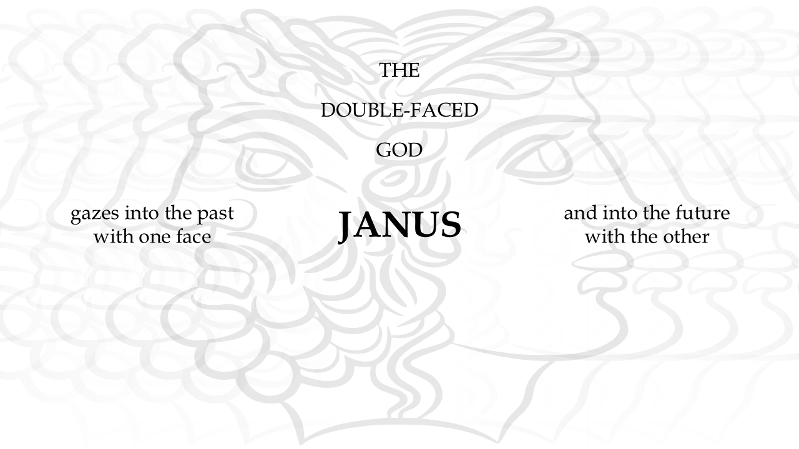

<p align="center">
  
</p>


<p align="center">
    <strong>The double-faced god Janus gazes into the past with one face, and into the future with the other.</strong>
</p>


<h3 align="center">
  Past, Future, All at Once:<br />
  Mitigating Stability-Plasticity Dilemma via Post-hoc JANUS Rectification
</h3>
<p align="center">
  🎉 <strong>Accepted at NeurIPS 2026!</strong><br />
  <a href="https://arxiv.org/abs/2609.19985">📄 Paper</a> ·
  <a href="#installation">🛠️ Installation</a> ·
  <a href="#quick-start">🚀 Quick Start</a> ·
  <a href="#citation">📚 Citation</a>
</p>


<p align="center">
  Zhilong Zheng*, Letian Tao*, Yujie Yang, Wei Xiong,<br />
  Kehua Sheng, Bo Zhang, Jingliang Duan, Keqiang Li, Yang Guan, Shengbo Eben Li
</p>


<p align="center">
  Tsinghua University · DiDi Autonomous Driving
</p>


## 💡 Overview

**JANUS** (**JA**cobian **NU**ll **S**pace projection) is a **post-hoc, tuning-agnostic weight rectification framework** for mitigating catastrophic forgetting in fine-tuned foundation models. It takes a pretrained model and its fine-tuned counterpart, then rectifies the parameter updates to recover historical knowledge while retaining downstream task adaptation.

Named after the two-faced Roman god who looks toward both the past and the future, JANUS connects two goals: remembering what a model already knows and learning something new.

The [paper](https://arxiv.org/abs/2609.19985) evaluates JANUS on **LLaMA-2-7B** and **LLaMA-3-8B** across math, code generation, and instruction following. Rectification experiments use a single NVIDIA A100 80GB GPU.

## 📊 Selected Results

The following values are the reported means from the main LLaMA-2-7B results table in the [arXiv paper](https://arxiv.org/abs/2609.19985). JANUS-P applies post-hoc rectification to PiSSA.

| Task                  | Method      | Stability $\mathrm{AP}_1$ (%) ↑ | Plasticity $\mathrm{AP}_2$ (%) ↑ | Overall $\mathrm{AP}$ (%) ↑ |
| :-------------------- | :---------- | ------------------------------: | -------------------------------: | --------------------------: |
| Math                  | PiSSA       |                           67.55 |                            72.56 |                       70.05 |
| Math                  | **JANUS-P** |                      **106.16** |                            71.54 |                   **88.85** |
| Code                  | PiSSA       |                           79.71 |                            75.94 |                       77.83 |
| Code                  | **JANUS-P** |                      **109.83** |                            75.19 |                   **92.51** |
| Instruction following | PiSSA       |                           79.53 |                            81.80 |                       80.67 |
| Instruction following | **JANUS-P** |                      **100.27** |                            75.58 |                   **87.93** |

- **Stability** $\mathrm{AP}_1$: the mean score on TriviaQA, NQ Open, and WebQS, after normalizing each benchmark score by the pretrained model's score.
- **Plasticity** $\mathrm{AP}_2$: the mean score on downstream benchmarks, after normalizing each benchmark score by the full fine-tuning baseline's score for that task.
- **Overall performance** $\mathrm{AP}=(\mathrm{AP}_1+\mathrm{AP}_2)/2$.

A stability score above 100% indicates that the normalized average exceeds the pretrained baseline on these knowledge benchmarks. See the paper for standard deviations, LLaMA-3-8B results, other fine-tuning methods, and ablations.

<a id="installation"></a>

## 🛠️ Installation

```bash
git clone git@github.com:zhengzl18/JANUS.git
cd JANUS
conda create -n janus python=3.11
conda activate janus
pip install -r requirements.txt
```

<a id="quick-start"></a>

## 🚀 Quick Start

### 1. Prepare the models and replay cache

You need the **original pretrained model** and a **fine-tuned checkpoint derived from that same model**. `--base_model_id` accepts a Hugging Face model ID or a local model directory. The checkpoint supplied through `--finetuned_model_path` depends on the fine-tuning method:

| `--finetuned_model_type` | Input at `--finetuned_model_path` | Additional preparation                                       |
| :----------------------- | :-------------------------------- | :----------------------------------------------------------- |
| `lora`                   | A PEFT LoRA adapter directory     | -                                                            |
| `pissa`                  | A PEFT PiSSA adapter directory    | Supply the matching PiSSA residual model through `--residual_model_path`. |
| `ff`                     | A full fine-tuned model directory | Follow the code's requirement to train, save, and load the checkpoint in `float16`. |

For every mode, the fine-tuned directory must also contain **`tokenizer_config.json` with a `model_max_length` field**. The entry point reads this field directly and loads the tokenizer from `--base_model_id`. If your training process saved only adapter weights, also save the tokenizer configuration there with the sequence length used for your experiment.

In [datautils.py](datautils.py), replace the cache placeholder with a writable directory:

```python
CACHE_ROOT = "/path/to/your/cache"
```

The script automatically loads the knowledge dataset, shuffles it, and selects examples as the historical replay set. Use `--replay_dataset`, `--replay_size`, and `--replay_seed` to configure the replay data. The default setting reproduces the paper's replay setup: 256 randomly selected NQ Open examples with seed 233. Tokenized examples are cached under `CACHE_ROOT/knowledge_data/`. The current data loader accepts `trivia_qa`, `nqopen`, and `webqs`; using another replay dataset requires extending `get_knowledge_data`.

### 2. Rectify a finetuned checkpoint

Run the following from the repository root, replacing the example paths with your own:

```bash
CUDA_VISIBLE_DEVICES=0 python main.py \
  --base_model_id /path/to/original/base_model \
  --finetuned_model_path /path/to/adapter \
  --finetuned_model_type lora \
  --threshold 0.95 \
  --beta 0.7 \
  --save_path ./path/to/save/janus-rectified
```

### Command-line arguments

| Argument                 | Default          | Description                                                  |
| :----------------------- | :--------------- | :----------------------------------------------------------- |
| `--base_model_id`        | Must be supplied | Original pretrained model ID or local path.                  |
| `--finetuned_model_path` | Must be supplied | Fine-tuned model or adapter directory.                       |
| `--finetuned_model_type` | Must be supplied | One of `ff`, `lora`, or `pissa`.                             |
| `--residual_model_path`  | `None`           | PiSSA residual model path. Required when `--finetuned_model_type pissa` is used. |
| `--replay_dataset`       | `nqopen`         | Historical replay dataset. Currently supports `trivia_qa`, `nqopen`, and `webqs`. |
| `--replay_size`          | `256`            | Number of examples sampled for historical replay.            |
| `--replay_seed`          | `233`            | Random seed used when shuffling and sampling replay examples. |
| `--threshold`            | `0.95`           | Accept a candidate step when the mean principal-angle cosine is greater than this value. Use a value strictly between 0 and 1. |
| `--beta`                 | `0.7`            | Multiply a rejected step size by this factor. Use a value strictly between 0 and 1. |
| `--r_jac_approx`         | `32`             | Rank used for the sequence-level SVD approximation of the Jacobian. |
| `--save_path`            | Must be supplied | Directory for the output checkpoint and temporary Jacobian cache. |

## 🧪 Evaluation

Evaluation templates are provided in [scripts](scripts).

| Capability                 | Benchmarks               | Script                                                       | Evaluation framework                                         |
| :------------------------- | :----------------------- | :----------------------------------------------------------- | :----------------------------------------------------------- |
| Historical world knowledge | TriviaQA, NQ Open, WebQS | [`word_knowledge.sh`](scripts/word_knowledge.sh)             | [LM Evaluation Harness](https://github.com/EleutherAI/lm-evaluation-harness)(v0.4.9.1) |
| Math                       | GSM8K, MATH              | [`math.sh`](scripts/math.sh)                                 | [PiSSA evaluation utilities](https://github.com/MuLabPKU/PiSSA)（commit a6e4c9c） |
| Code generation            | HumanEval, MBPP          | [`code-humaneval.sh`](scripts/code-humaneval.sh), [`code-mbpp.sh`](scripts/code-mbpp.sh) | [BigCode Evaluation Harness](https://github.com/bigcode-project/bigcode-evaluation-harness)(commit 8fc5bae) |
| Instruction following      | MT-Bench                 | [`instruction following.sh`](scripts/instruction%20following.sh) | [FastChat](https://github.com/lm-sys/FastChat)(commit 587d5cf) |

Reproduction details:

- **HumanEval:** temperature `0.2`, `200` samples; report `pass@1`.
- **MBPP:** temperature `0.1`, `15` samples; report `pass@1`.
- **Code evaluation:** generation and scoring run as separate stages. Match `--load_generations_path` to the task-specific filename produced by the generation stage. The supplied scripts enable execution of generated code; follow the upstream harness's isolated execution guidance.
- **MT-Bench:** the supplied template uses GPT-4 as the judge, as in the paper, and requires access to that judge. The paper reports **first-turn scores**; filter the judge results to turn 1 when reproducing them.

<a id="citation"></a>

## 📚 Citation

If you find JANUS useful in your research, please cite our paper:

```bibtex
@article{zheng2026janus,
  title   = {Past, Future, All at Once: Mitigating Stability-Plasticity Dilemma via Post-hoc {JANUS} Rectification},
  author  = {Zheng, Zhilong and Tao, Letian and Yang, Yujie and Xiong, Wei and Sheng, Kehua and Zhang, Bo and Duan, Jingliang and Li, Keqiang  and Guan, Yang and Li, Shengbo Eben},
  journal = {arXiv preprint arXiv:2609.19985},
  year    = {2026},
  url     = {https://arxiv.org/abs/2609.19985}
}
```

## 🤝 Acknowledgements

This implementation builds on [PEFT](https://github.com/huggingface/peft), [CorDA](https://github.com/iboing/CorDA/tree/main), and [PiSSA](https://github.com/MuLabPKU/PiSSA). We also thank the developers of PiSSA, LM Evaluation Harness, BigCode Evaluation Harness, and FastChat for their training and evaluation tools.

## 📄 License

This project is licensed under the [Apache License 2.0](LICENSE).

